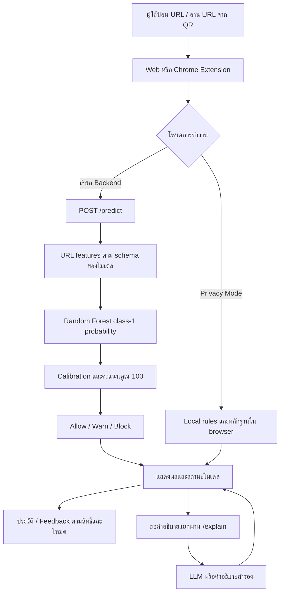

# Phish Radar AI — เอกสารอธิบายโครงงานสำหรับส่งอาจารย์

จัดทำวันที่ **29 ตุลาคม 2569 (2026-10-29, Asia/Bangkok)**

Phish Radar AI เป็นโครงงานต้นแบบสำหรับช่วยประเมินความเสี่ยงของ URL และอธิบายหลักฐานให้ผู้ใช้พิจารณาก่อนเปิดลิงก์หรือกรอกข้อมูลสำคัญ ประกอบด้วย Web Application ภาษาไทย, Chrome Extension และ Backend สำหรับคำนวณคะแนน เชื่อมฐานข้อมูลสมาชิก และขอคำอธิบายจาก LLM

เอกสารชุดนี้อธิบาย **source ของโครงการหลักที่คัดมาสำหรับ branch `submission/latest-project-20261029`** พร้อมหลักฐานโมเดลและผลประเมินเดิม โค้ดใน branch นี้ใช้ศึกษาการทำงานและเตรียมสาธิตได้ แต่ไม่ได้แนบ model binary, raw dataset หรือการตั้งค่าส่วนตัว จึงต้องเตรียม artifact ที่ตรงรุ่นเพิ่มเติมก่อนสาธิต RF ครบระบบ การมี source และผลประเมินใน repository ไม่ใช่หลักฐานว่าเซิร์ฟเวอร์ออนไลน์หรือทุกฟังก์ชันผ่านการทดสอบจริงแล้ว

## 1. ปัญหาและวัตถุประสงค์

ลิงก์หลอกลวงอาจใช้ชื่อโดเมนคล้ายบริการจริง ซ่อน URL ปลายทางไว้ในพารามิเตอร์ ใช้ subdomain จำนวนมาก หรือชักจูงให้ผู้ใช้กรอกข้อมูลส่วนตัว ผู้ใช้จึงต้องการข้อมูลประกอบการตัดสินใจที่เข้าใจง่ายก่อนใช้งานลิงก์

โครงงานมีวัตถุประสงค์ดังนี้

1. วิเคราะห์โครงสร้าง URL และคำนวณคะแนนความเสี่ยงจากแบบจำลอง Random Forest ที่บันทึกไว้
2. แสดงผลตามนโยบาย Allow / Warning / Block พร้อมหลักฐานและสถานะความพร้อมของโมเดล
3. ให้ผู้ใช้ตรวจ URL ผ่าน Web Application และรับความช่วยเหลือใน browser ผ่าน Chrome Extension
4. จัดการบัญชี ประวัติผลตรวจ Feedback และสิทธิ์ผู้ดูแล เพื่อให้ตรวจย้อนกลับการใช้งานได้
5. ใช้ LLM ช่วยอธิบายผลภาษาไทย โดยให้คะแนนและการตัดสินใจมาจากเส้นทางประเมินที่กำหนดไว้
6. แยกการทำงานภายใน browser, การคำนวณบน backend และการขอคำอธิบาย เพื่อให้ผู้ใช้เห็นขอบเขตของแต่ละโหมด

ผล Allow หมายถึงคะแนนต่ำกว่าเกณฑ์ที่เลือก ไม่ใช่การรับรองว่าเว็บไซต์ปลอดภัยทุกกรณี

## 2. ลำดับอ่านสำหรับอาจารย์และผู้ตรวจโครงงาน

| ลำดับ | เอกสาร | เนื้อหาที่ตอบคำถาม |
| --- | --- | --- |
| สไลด์ | [สไลด์นำเสนอ (PDF)](slides/%E0%B9%80%E0%B8%88%E0%B8%B2%E0%B8%B0%E0%B8%A5%E0%B8%B6%E0%B8%81%E0%B8%A3%E0%B8%B0%E0%B8%9A%E0%B8%9A%E0%B9%81%E0%B8%A5%E0%B8%B0%E0%B8%9C%E0%B8%A5%E0%B8%97%E0%B8%94%E0%B8%AA%E0%B8%AD%E0%B8%9A%20Phish%20Radar%20AI.pdf) | ไฟล์สไลด์ที่แนบสำหรับประกอบการนำเสนอ |
| 1 | เอกสารหน้านี้ | โครงงานแก้ปัญหาอะไร พัฒนาอะไร และใช้ source ชุดใด |
| 2 | [การทำงานของระบบ](SYSTEM_WALKTHROUGH_TH.md) | สถาปัตยกรรม ลำดับ request การคำนวณคะแนน Web, Extension, API และฐานข้อมูล |
| 3 | [โมเดล ข้อมูล และผลประเมิน](MODEL_AND_DATA_TH.md) | รุ่น/hash/features สูตร ข้อมูลแต่ละชุด Recall/FPR และข้อจำกัดของผล |
| 4 | [การติดตั้งและสาธิต](SETUP_AND_DEMO_TH.md) | สิ่งที่ต้องเตรียม คำสั่งตั้งค่า การเปิดบริการ และแผนสาธิต |
| 5 | [ผลการตรวจสอบชุดส่ง](VERIFICATION_TH.md) | ตรวจอะไรในวันที่จัดทำ ผ่านอะไร และอะไรยังไม่ได้ตรวจ |
| 6 | [ข้อเท็จจริงจาก artifact](../paper/PROJECT_FACTS_TH.md) และ [ที่มาชุดข้อมูล](../paper/DATASET_SOURCES_TH.md) | หลักฐานเดิมที่ตรวจย้อนกลับไปยัง JSON และ hash ได้ |

คู่มือเขียนบทความเดิมอยู่ที่ [docs/paper](../paper/README.md) ส่วนแผนที่ให้ AI รับช่วงอยู่ที่ [docs/ai](../ai/README.md) วันที่ในเอกสารแต่ละชุดเป็นวันที่ของหลักฐานนั้น ไม่ควรเปลี่ยนผลประเมินเดิมให้กลายเป็นผลทดสอบใหม่วันที่ 29 ตุลาคม

## 3. ส่วนที่พัฒนาและหน้าที่

| ส่วน | เทคโนโลยี/จุดอ่าน | ความสามารถที่มีใน source |
| --- | --- | --- |
| Web Application | React 19, Vite; [web-app/package.json](../../web-app/package.json) | เข้าสู่ระบบ Dashboard ตรวจ URL/QR ประวัติผลตรวจ ตั้งค่า ความปลอดภัย สถานะบริการ และหน้าผู้ดูแล |
| Chrome Extension | Manifest V3 รุ่น 2.4.10; [manifest.json](../../extension/manifest.json) | วิเคราะห์ URL และ navigation, ช่วยตรวจลิงก์/ฟอร์ม/ผลค้นหา/clipboard, หน้าเตือน, QR, Safe Preview และกรองโฆษณาตามการตั้งค่า |
| Prediction API | FastAPI; [app.py](../../backend/app.py) | รับ URL คำนวณ features ใช้โมเดลและ calibration คืนคะแนน decision และ metadata |
| URL features | [feature_extractor.py](../../backend/feature_extractor.py) | โครงสร้าง URL, domain/host/path/query และ feature context ตาม schema ของ model bundle |
| สมาชิกและข้อมูล | SQLAlchemy + PyMySQL; [ฐานข้อมูล](../../database/mysql/README_TH.md) | ผู้ใช้ Session ประวัติ Feedback และ Audit Events พร้อมตรวจสิทธิ์ใน backend |
| คำอธิบายและแชต | [llm_explainer.py](../../backend/llm_explainer.py), [chat_router.py](../../backend/chat_router.py) | คำอธิบายผ่าน `/explain` รองรับ provider ตามการตั้งค่า; `/chat` สำหรับสมาชิกใช้ Ollama ใน source รุ่นนี้ |
| หลักฐานการทดลอง | [evidence](../paper/evidence/) | metadata โมเดล ผล evaluation/selection แบบการทดลอง และ provenance ของข้อมูล |

ตารางนี้ระบุความสามารถที่พบใน source การทดสอบฟังก์ชันจริงต้องแยกตามระดับใน [VERIFICATION_TH.md](VERIFICATION_TH.md) โดยเฉพาะข้อจำกัดของ browser, API, DB และ artifact ที่ไม่ได้เผยแพร่

## 4. ภาพรวมการไหลของข้อมูล



เส้นทาง RF ในภาพใช้ได้เมื่อมี artifact ที่ตรงรุ่นและ backend โหลดได้เท่านั้น กรณีไม่มีโมเดลหรือใช้ Privacy Mode ต้องแสดงสถานะของกรณีนั้นแยกจาก RF การกรองโฆษณาของ Extension เป็นการจัดการ DOM และไม่เปลี่ยนคะแนนโมเดล

## 5. สูตรและนโยบายของโมเดลที่อ้างในรายงาน

หลักฐานของโครงการหลักระบุ `url-risk-rf-reference-root-repair-support2-20261008`, schema `url-v10-reference-root-context`, **174 features** และ `fusion_method=ml_only`

```text
URL → 174 features → Random Forest P(class=1)
    → probability calibration → Score = 100 × calibrated output

Score < 60       → allow
60 ≤ Score < 80  → warn
Score ≥ 80       → block
```

Backend ตัดสินใจจากคะแนนก่อนปัดเศษ การปัดจำนวนเต็มเพื่อแสดงผลไม่ควรเปลี่ยน decision; ตัวอย่างขอบเขตคือ `59→allow`, `60→warn`, `79→warn`, `80→block` Rule/Fuzzy ใช้เป็นหลักฐานประกอบในโหมดนี้ และ LLM ใช้อธิบายผล ไม่เปลี่ยนคะแนนสุดท้าย

Model SHA256 ที่ผูกกับหลักฐานคือ

```text
bc4e024e32aaf0ad695ea4a4dff552ece09d606c4963a49e8bf6aa8a447575bb
```

สถานะของ artifact ยังเป็น `production_ready=false` และ `statistical_gate_passed=false` จึงเหมาะกับการศึกษาและสาธิตตามขอบเขตการทดลอง อ่านผล Recall ควบคู่ FPR ใน [MODEL_AND_DATA_TH.md](MODEL_AND_DATA_TH.md)

## 6. ฐาน source และสิ่งที่อยู่ใน GitHub

| บริบท | ความหมาย |
| --- | --- |
| Branch ชุดส่ง `submission/latest-project-20261029` | คัด source ปัจจุบันของโครงการหลักมาไว้ใน `backend/`, `web-app/`, `extension/`, `database/` ที่ root เพื่อให้เปิดอ่านได้ตรงกับคำอธิบายรุ่นใหม่ |
| Branch เดิม `docs/article-handoff-20261017` | ชุดส่งต่องานเขียนเดิมซึ่ง application ที่ root ยังเป็นฐานเก่าจากเดือนกันยายน อย่าใช้ hash/model ของ branch เดิมแทนรุ่นที่อ้างในชุดส่งนี้ |
| [CURRENT_SOURCE_MANIFEST.json](../ai/CURRENT_SOURCE_MANIFEST.json) และ [current-source.zip](../ai/current-source.zip) | รายชื่อ source และ SHA256 ของสำเนาสำหรับตรวจความตรงกัน ใช้วันที่และจำนวนไฟล์จาก manifest ที่แนบจริง |
| [evidence/source-manifest.json](../paper/evidence/source-manifest.json) | บันทึก provenance เดิมของหลักฐานโมเดล/ข้อมูล รวมถึงความต่างจาก nested repository ณ วันที่ตรวจเดิม |

ชุดเผยแพร่มี source, `.env.example`, lockfile ของ Web, SQL, สคริปต์ตรวจสอบ และเอกสารหลักฐาน ส่วนที่ไม่ได้แนบ ได้แก่ `.env`/รหัสผ่าน/token, model binary, raw datasets, `reference-origin-v1.json` ต้นฉบับ, `model-demo-authorization.json`, dependency folders, build output, logs และประวัติส่วนตัว

reference-origin registry และ demo authorization ต้นฉบับมีข้อจำกัดด้านข้อมูลชั่วคราวหรือ path เฉพาะเครื่อง จึงเก็บเพียง hash/status ในหลักฐาน ไม่ควรสร้างไฟล์ทดแทนแล้วอ้างว่าเป็นต้นฉบับเดียวกัน

## 7. วิธีเริ่มอ่านจาก GitHub

```powershell
git clone --branch submission/latest-project-20261029 --single-branch https://github.com/Kmaichoun/Phishing_AI_Extension_Demo.git
Set-Location Phishing_AI_Extension_Demo
python scripts/inspect_project_context.py --json --verify-snapshot
```

ถ้า `python` เป็น Windows Store alias ให้ใช้ Python executable ที่ติดตั้งจริง การรัน inspector ใช้ standard library และไม่ต้องติดตั้ง dependencies ก่อน เป็นเพียง inventory แบบอ่านอย่างเดียว ไม่โหลด pickle ไม่อ่าน `.env` และไม่เรียกบริการ

ขั้นตอนเปิดระบบทั้งหมดอยู่ใน [SETUP_AND_DEMO_TH.md](SETUP_AND_DEMO_TH.md) ให้เตรียม artifact ที่ขาดตามระดับการสาธิตที่ต้องการ

## 8. ข้อจำกัดที่ควรกล่าวในการนำเสนอ

- ผลประเมินเป็นผลเดิมที่ผูกกับ artifact/hash ไม่ได้ประเมินโมเดลใหม่ในวันจัดทำเอกสาร
- ยังไม่มีหลักฐาน fresh forward-temporal test ครบ benign/phishing ที่ใช้รับรองการทำงานทั่วอินเทอร์เน็ต และประวัติการสัมผัสข้อมูลของ baseline บางส่วนยังไม่ครบ
- คะแนน calibrated output ไม่ใช่การรับรองความน่าจะเป็นจริงของ URL ทุกบริบท และชื่อโดเมนที่เป็น reference ไม่ใช่ allowlist ครอบคลุมทุกหน้าของโดเมน
- ไม่มีผล user study, ความพึงพอใจ, latency หรือความพร้อมบริการออนไลน์จากการตรวจ source เพียงอย่างเดียว
- ปุ่ม Safe Preview และการตรวจ navigation ไม่รับรองว่าจะป้องกันทุก request หรือทำให้เว็บอันตรายปลอดภัย ควรสาธิตด้วย URL และหน้า fixture ที่ควบคุมได้

ชื่อผู้จัดทำ รหัสนิสิต สาขา อาจารย์ที่ปรึกษา และรูปแบบอ้างอิงสำหรับรายวิชา ให้เจ้าของโครงงานยืนยันตามข้อกำหนดของสถาบัน
