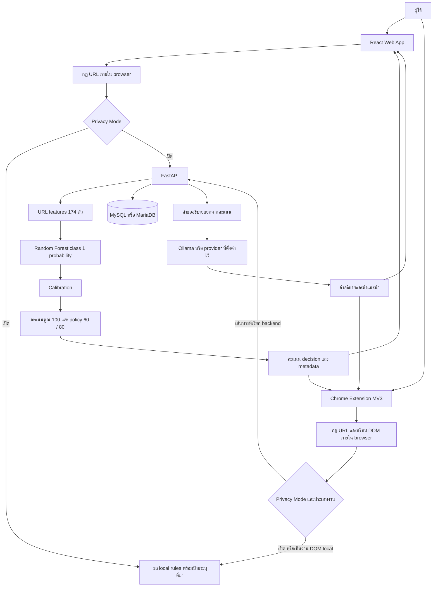
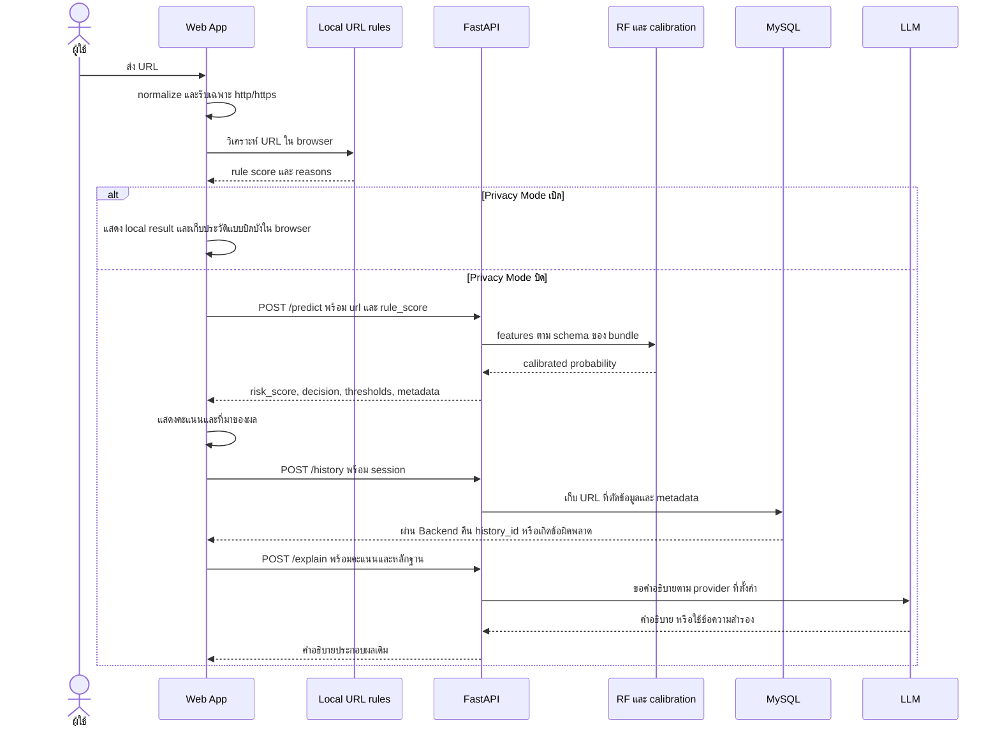
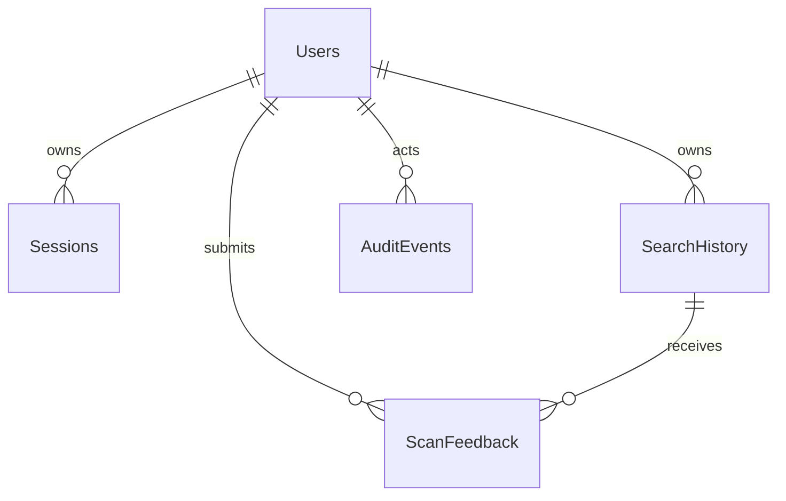

# การทำงานของระบบ Phish Radar AI สำหรับส่งอาจารย์

วันที่จัดทำเอกสาร: **29 ตุลาคม 2569 (2026-10-29, Asia/Bangkok)**

เอกสารนี้อธิบายการทำงานจาก source code ของโครงการหลักที่ใช้จัดทำชุดส่งงาน โดยตรวจเทียบกับ curated source snapshot วันที่ 20 ตุลาคม 2026 และหลักฐานโมเดลที่เผยแพร่ใน `docs/paper/evidence/` วันที่เขียนเอกสารไม่ใช่วันที่ฝึกโมเดลหรือวันที่เก็บ URL ทุกแหล่ง เนื้อหานี้เป็นผลตรวจ source และหลักฐานที่บันทึกไว้ ไม่ใช่รายงานว่า API, MySQL, Ollama, กล้อง หรือส่วนขยายทำงานครบวงจรแล้วในวันจัดทำ

## 1. ขอบเขตและรุ่นที่อ้างอิง

Phish Radar AI เป็นโครงงานประเมินความเสี่ยงของ URL ประกอบด้วย Web App, Chrome Extension, FastAPI Backend, ฐานข้อมูลบัญชีและประวัติ และบริการคำอธิบายจาก LLM ผู้ใช้รับคะแนน เกณฑ์ตัดสิน และเหตุผลประกอบเพื่อช่วยตัดสินใจก่อนเปิดลิงก์หรือกรอกข้อมูลสำคัญ คะแนนต่ำไม่ได้รับรองเนื้อหาของเว็บไซต์ปลายทาง

| รายการ | รุ่นหรือขอบเขตที่อ้างอิง |
|---|---|
| Web App | package version `2.0.0`; React 19.1.1 และ Vite 7.1.4 ตาม dependency declarations |
| Backend API | FastAPI application version `2.0.0` |
| Chrome Extension | Manifest V3, version `2.4.10` |
| โมเดลที่หลักฐานอ้างถึง | `url-risk-rf-reference-root-repair-support2-20261008` |
| Model SHA256 | `bc4e024e32aaf0ad695ea4a4dff552ece09d606c4963a49e8bf6aa8a447575bb` |
| Feature schema ของโมเดลที่อ้าง | `url-v10-reference-root-context`, 174 features |
| สูตรของ artifact ที่อ้าง | `Score = 100 × Calibrate(Random Forest)`; `fusion_method=ml_only` |
| สถานะ | `experimental_demo`, `production_ready=false`, `statistical_gate_passed=false` |

อ่านหลักฐานที่ [PROJECT_FACTS_TH.md](../paper/PROJECT_FACTS_TH.md), [active-model.json](../paper/evidence/active-model.json) และ [CURRENT_SOURCE_MANIFEST.json](../ai/CURRENT_SOURCE_MANIFEST.json) ก่อนนำผลไปอธิบายระบบที่เปิดจริง การมี source บน GitHub ไม่ยืนยันว่าเครื่องที่รันใช้ model hash เดียวกัน

ชุด source ที่เผยแพร่ไม่แนบ `.env`, credentials, model binary, raw datasets หรือ authorization/reference registry ต้นฉบับที่ถูกตัดออกด้วยเหตุผลด้านข้อมูลเฉพาะเครื่อง จึงอ่าน implementation ได้ แต่การ clone เพียงอย่างเดียวยังไม่พอเปิด demo ของโมเดลที่อ้าง ต้องใช้ artifact และการตั้งค่าที่ตรงกันจากผู้ดูแลโครงการ

## 2. สถาปัตยกรรมโดยรวม



Backend ประเมินคุณลักษณะจาก URL และ metadata ของโมเดล เส้นทาง `/predict` ไม่ใช่ browser ที่เปิดเว็บไซต์เป้าหมายเพื่อรับรองเนื้อหา ส่วนการตรวจฟอร์ม โลโก้ ข้อความบนหน้า และตำแหน่งลิงก์เป็นอีกชั้นหนึ่งของ Extension ที่ทำงานในหน้าเว็บจริง ผลจาก DOM ต้องแยกจากคะแนน RF

ส่วนประกอบหลักและ source สำหรับตรวจย้อนกลับ:

| ส่วนประกอบ | หน้าที่ | Source |
|---|---|---|
| Web state | จัดลำดับการตรวจ เก็บผล สถานะบริการ ประวัติ และ Privacy Mode | [AppContext.jsx](../../web-app/src/contexts/AppContext.jsx) |
| API adapter | ส่ง HTTP request, cookies ของบัญชี, timeout และตรวจความครบของ prediction ขั้นต้น | [api.js](../../web-app/src/services/api.js) |
| Backend | model loading, prediction, policy, health และประกอบ router | [app.py](../../backend/app.py) |
| Feature extraction | normalize URL, public suffix/domain context และ feature schema แต่ละรุ่น | [feature_extractor.py](../../backend/feature_extractor.py) |
| Extension worker | settings, navigation checks, badge, หน้าเตือน และส่งงานให้ backend | [background.js](../../extension/background.js) |
| Extension content | ตรวจลิงก์ ฟอร์ม บริบทแบรนด์ และแสดงตำแหน่งหลักฐาน | [content.js](../../extension/content.js) |
| Database | SQLAlchemy/PyMySQL และ readiness ของ schema | [database.py](../../backend/database.py) |
| LLM | เตรียมหลักฐาน ลดข้อมูล URL ที่ส่ง อธิบาย และ fallback | [llm_explainer.py](../../backend/llm_explainer.py) |

เทคโนโลยีดูจาก [web-app/package.json](../../web-app/package.json), [backend/requirements.txt](../../backend/requirements.txt) และ [extension/manifest.json](../../extension/manifest.json) เวอร์ชันที่ประกาศใน package ไม่ใช่ผลตรวจเวอร์ชัน dependency ที่ติดตั้งอยู่บนเครื่องใดเครื่องหนึ่ง

## 3. หน้าจอและการใช้งานของ Web App

Web ใช้ hash routing เช่น `#/scan` ไม่ใช่ backend route `/scan` โดยตรง หน้าอื่นนอกจาก login ถูกครอบด้วย `ProtectedRoute` ซึ่งรอผล session แล้วส่งผู้ที่ยังไม่เข้าสู่ระบบไปหน้า login พร้อม `next` route การซ่อนหน้าใน browser เป็นเพียงส่วนของ UI; Backend ตรวจสิทธิ์ซ้ำสำหรับข้อมูลบัญชีและผู้ดูแล

| Route | ผู้ใช้และงานที่ทำได้ | Source |
|---|---|---|
| `#/login` | สมัครสมาชิก เข้าสู่ระบบ และไปหน้าที่ต้องการหลังยืนยันบัญชี | [LoginPage.jsx](../../web-app/src/pages/LoginPage.jsx) |
| `#/scan` | กรอก URL ดูคะแนน ผลตัดสิน สถานะโมเดล คำอธิบาย และส่ง feedback | [ScannerPage.jsx](../../web-app/src/pages/ScannerPage.jsx) |
| `#/qr` | อ่าน QR จากภาพหรือกล้อง ตรวจ URL ที่ decode แล้วกดส่งเข้าสู่ Scanner | [QrPage.jsx](../../web-app/src/pages/QrPage.jsx) |
| `#/dashboard` | ดูประวัติส่วนตัว ค้น URL/decision/ช่วงวันที่ ดูแนวโน้ม 14 วัน และส่งออกข้อมูลในหน้าปัจจุบัน | [DashboardPage.jsx](../../web-app/src/pages/DashboardPage.jsx) |
| `#/settings` | ปรับข้อมูลบัญชี เปลี่ยนรหัสผ่าน และการตั้งค่าที่หน้าให้บริการ | [SettingsPage.jsx](../../web-app/src/pages/SettingsPage.jsx) |
| `#/security` | ดู session ที่ยังใช้งาน และเพิกถอน session อื่นของบัญชีตนเอง | [SecurityPage.jsx](../../web-app/src/pages/SecurityPage.jsx) |
| `#/status` | แยกสถานะ Backend, model, database และ LLM | [StatusPage.jsx](../../web-app/src/pages/StatusPage.jsx) |
| `#/methodology` | อธิบายวิธีประเมินและข้อจำกัดให้ผู้ใช้เข้าใจคะแนน | [MethodologyPage.jsx](../../web-app/src/pages/MethodologyPage.jsx) |
| `#/admin` | ผู้ดูแลจัดสิทธิ์บัญชี ทบทวน feedback ดู catalog การทดลอง และ audit log | [AdminPage.jsx](../../web-app/src/pages/AdminPage.jsx) |

ที่มาเส้นทางจริง: [App.jsx](../../web-app/src/App.jsx), [RouterContext.jsx](../../web-app/src/contexts/RouterContext.jsx), [ProtectedRoute.jsx](../../web-app/src/components/ProtectedRoute.jsx) และ [AuthContext.jsx](../../web-app/src/contexts/AuthContext.jsx)

ตัวอย่าง user story ของสมาชิก: เข้าสู่ระบบ → วางลิงก์ใน Scanner → เห็นผลคะแนนและ decision → อ่านเหตุผล/คำอธิบาย → ดูผลเดิมใน Dashboard → ส่ง feedback ถ้าคิดว่าระบบเตือนผิด ทั้งนี้การบันทึกประวัติและ feedback ต้องมีฐานข้อมูลและ session ที่ใช้ได้ แม้ผลตรวจ URL อาจยังแสดงได้เมื่อฐานข้อมูลขัดข้อง

## 4. ลำดับการตรวจ URL บน Web



รายละเอียดจาก [AppContext.jsx](../../web-app/src/contexts/AppContext.jsx#L272):

1. ตัดช่องว่าง เติม `https://` เมื่อยังไม่มี scheme แล้ว parse ด้วย `URL`; ปฏิเสธ URL ที่ parse ไม่ได้หรือ protocol อื่น
2. เรียก analyzer ใน browser เพื่อสร้าง `ruleScore`, เหตุผล, ประเภทสัญญาณ และข้อมูลแบรนด์ประกอบ
3. ถ้า Privacy Mode ปิด ให้เรียก `/predict`; ถ้าคำขอล้มเหลวใช้ผลกฎในเครื่องพร้อม `model_status=offline` และ error ที่เกี่ยวข้อง
4. เก็บ `risk_probability`, `risk_score`, `decision`, thresholds, model/policy/schema version และ `layer_results` แยกจาก rule score เมื่อโมเดลไม่ ready ค่า ML ใน UI ไม่ควรถูกอธิบายว่าเป็น RF prediction
5. แสดงผลตรวจ จากนั้นพยายามบันทึก `/history`; หากฐานข้อมูลล้มเหลวผลตรวจยังแสดงได้และมีข้อความว่าบันทึกประวัติไม่สำเร็จ
6. เรียก `/explain` แยกหลังได้ผลตรวจ คำอธิบายที่สำเร็จหรือ fallback ถูกเพิ่มในผลเดิม ไม่มีขั้นตอนเอาข้อความ LLM กลับไปคำนวณคะแนน
7. ใช้ scan generation ป้องกันผลตอบกลับของคำขอเก่าเขียนทับ scan ที่ผู้ใช้เริ่มใหม่

API adapter [api.js](../../web-app/src/services/api.js#L13) ตั้ง timeout ทั่วไป 15 วินาที และ `/explain`/`/chat` 120 วินาที ตรวจ HTTP status และตรวจ prediction ขั้นต้นว่ามี `ok`, คะแนนจำนวนจริง และ `model_status` ส่วน `/predict` กับ `/explain` ใช้ `credentials: omit`; API ของบัญชีใช้ cookie ตามค่าเริ่มต้น

URL ของ Backend มาจาก `VITE_API_BASE` ถ้ากำหนดไว้ ถ้าไม่กำหนดใช้ local host mapping หรือ origin เดียวกับ Web ตาม [runtime.js](../../web-app/src/services/runtime.js) จึงต้องตั้งค่าให้ตรงสถานที่ deploy

## 5. การคำนวณคะแนนและเกณฑ์ตัดสิน

### 5.1 การเลือก artifact และ feature schema

Backend อ่าน `backend/model.pkl` และ cache bundle ตามเวลาแก้ไขไฟล์ หากเป็น artifact ที่ระบุ `production_ready=false` โค้ดต้องพบ demo authorization ที่ผูกกับ model SHA256 ก่อนใช้งาน สำหรับ v9/v10 ต้องตรวจ hash ของ reference-origin registry ให้ตรงกับ metadata ของ bundle ด้วย ดู [app.py](../../backend/app.py#L70) และ [demo_model.py](../../backend/demo_model.py)

`feature_extractor.py` รองรับหลาย schema เพื่อรักษาความหมายของโมเดลเดิม แม้ default constant ของ extractor ยังเป็น `url-v4-public-suffix` แต่ `/predict` เลือก schema จาก bundle ที่โหลดอยู่ ดังนั้นห้ามอ่าน default constant เพียงตัวเดียวแล้วสรุปว่าโมเดลที่อ้างใช้ v4

โมเดลที่หลักฐานระบุใช้ 174 features ได้แก่โครงสร้าง URL, บริบท registered domain/subdomain, hashed character n-grams ของ domain, สัญญาณ credential/redirect และ publisher-reference context คอลัมน์ `query_length` และ `num_params` ไม่อยู่ใน feature vector รุ่นนี้ แต่ยังมีการใช้ query บางลักษณะ เช่น nested URL และชื่อพารามิเตอร์สำคัญ จึงไม่ควรอธิบายว่า query ถูกละทิ้งทั้งหมด

`publisher_reference_origin_match` ตรวจ exact HTTPS origin จาก metadata ผู้เผยแพร่ ส่วน `publisher_reference_root_context` ใช้เงื่อนไข path รากเว็บไซต์และไม่มี hazard/query ที่โค้ดกำหนด ทั้งสองเป็น learned inputs ไม่ใช่ allowlist ที่รับรองทุกหน้าของโดเมน ดู [feature_extractor.py](../../backend/feature_extractor.py#L140) และ [reference_origin_features.py](../../backend/reference_origin_features.py)

### 5.2 สูตรของโมเดลที่อ้าง

ให้ `p_raw` เป็น probability ของ class `1` ที่ RF คืนมา และ `p_cal` เป็นค่าหลัง calibration:

```text
p_raw = RandomForest.predict_proba(features)[class = 1]
p_cal = sigmoid(7.325676952040592 × p_raw − 3.4861145043219683)
Score = 100 × p_cal
```

coefficients ข้างต้นมาจากหลักฐานของ artifact ที่ระบุ hash ไม่ใช่ค่าคงที่ของโมเดลทุกรุ่น `/predict` เรียก calibrator ที่อยู่ใน bundle จริง ดู [PROJECT_FACTS_TH.md](../paper/PROJECT_FACTS_TH.md) และ [app.py](../../backend/app.py#L263)

เมื่อ `fusion_method=ml_only`:

- `risk_score_value = ml_score_value`; ไม่มีการบวก Rule/Fuzzy เข้าไปในคะแนนสุดท้าย
- local rules มีสถานะ `explanation_only`; fuzzy และ consensus guardrail มีสถานะ `not_used`
- LLM อธิบายผลที่คำนวณแล้ว และไม่มีสิทธิ์เปลี่ยนคะแนนหรือ policy
- source ยังมี learned fusion และ 40/60 เพื่อรองรับ artifact เก่า จึงต้องอ่านค่าจาก bundle แทนการใช้ชื่อโฟลเดอร์หรือ formula default อธิบายทุกรุ่น

### 5.3 Policy 60/80 และการปัดเศษ

| คะแนนทศนิยมที่ Backend ใช้ | Decision | ความหมาย |
|---|---|---|
| `<60` | `allow` | ยังไม่ถึงเกณฑ์เตือนของโครงการ |
| `>=60` และ `<80` | `warn` | ถึงเกณฑ์เตือนและควรตรวจเพิ่ม |
| `>=80` | `block` | ถึงเกณฑ์ที่ระบบออกผลให้หยุด/เตือนการเข้าถึง |

Backend ตัดสินด้วยคะแนนก่อนปัดเศษ แล้วคืนคะแนนจำนวนเต็มสำหรับแสดงผล ตัวอย่างเชิงอธิบาย: คะแนน 59.6 แสดง 60 ได้ แต่ decision ยังเป็น `allow`; 79.6 แสดง 80 ได้แต่ decision ยังเป็น `warn` Client ควรเคารพ decision ที่ Backend คืนมา ดู [app.py](../../backend/app.py#L191), [app.py](../../backend/app.py#L345) และ [ml-feedback-client.js](../../extension/ml-feedback-client.js#L71)

หลักฐานเดิมมี isolated boundary check `59→allow`, `60→warn`, `79→warn`, `80→block` ผ่าน แต่ไม่ใช่หลักฐานว่า Web/Extension ที่ติดตั้งจริงผ่านทุกเส้นทางในวันจัดทำ

## 6. Chrome Extension ทำงานอย่างไร

Extension ใช้ service worker และ content scripts โดย [manifest.json](../../extension/manifest.json) กำหนด `document_start`, สิทธิ์ tabs/storage/webNavigation/scripting/clipboardRead และ host permissions ที่ครอบคลุม URL ตาม manifest ผู้ใช้ต้องโหลด extension รุ่นที่ถูกต้องและ reload หลังอัปเดต source

| เส้นทาง | การประเมินหลัก | พฤติกรรม |
|---|---|---|
| Direct navigation | service worker เรียก local rules แล้ว `/predict` เมื่อเงื่อนไขอนุญาต | ถ้าถึงเกณฑ์เตือน เปลี่ยน tab ไป `warning.html` |
| Popup/manual analysis | ส่ง message มาที่ `ANALYZE_URL` | worker รวมผล API กับ local evidence แล้วตอบกลับ |
| ลิงก์ใน DOM/ผลค้นหา | local rules กับข้อความลิงก์และบริบทหน้า | ใส่ badge, tooltip, ชี้ตำแหน่ง และดัก click ตามเงื่อนไข |
| ฟอร์ม/ช่องข้อมูลสำคัญ | local rules กับ page context | แสดง overlay และดักการส่งฟอร์มบางกรณี |
| Clipboard paste | อ่าน URL จาก paste event ในหน้า | เตือนหรือหยุดการวางเมื่อ local score ถึงเกณฑ์ |
| คำอธิบาย | `/explain` เมื่อเปิด LLM และปิด Privacy Mode | คำแนะนำประกอบผล ไม่เปลี่ยนคะแนน |
| Feedback | CSV endpoint หรือ local storage เมื่อ Privacy Mode | เป็นคนละ workflow กับ feedback บัญชี Web |

Worker อ่าน settings จาก `chrome.storage.sync` เช่น page scanning, highlight links, protect forms, search/clipboard protection, threshold, Privacy Mode และ ad filtering ค่าเริ่มต้นคือ threshold 60, เปิด page scanning และปิด LLM ดู [background.js](../../extension/background.js#L9)

Direct navigation ใช้ `webNavigation.onBeforeNavigate` เฉพาะ top frame, URL http/https, และผ่านเงื่อนไข settings, allowed-once, whitelist, trusted Web App และ Safe Preview แล้วจึงขอผล `/predict` ดู [background.js](../../extension/background.js#L460) navigation hook และการเปลี่ยน URL ของ tab ไม่ได้พิสูจน์ว่าทุก network request ถูกบล็อกก่อนถึงปลายทาง

ต้องแยก **whitelist ของ URL navigation ที่ผู้ใช้เพิ่ม**, **exact-host exception ของ ad filtering**, และ **publisher-reference features ของ RF** ออกจากกัน ทั้งสามมีขอบเขตต่างกัน ad-filter exception ไม่ยกเว้น URL-risk checks และ publisher-reference match ไม่ใช่ navigation whitelist

Content script ตรวจลิงก์ที่พบใน DOM ใช้ known link-shim rules สำหรับแกะปลายทางบางชนิด และแยกข้อความผลค้นหาเพื่อลดการนำ snippet ยาว ๆ ไปเป็นหลักฐาน URL โดยไม่เหมาะสม มี MutationObserver ตรวจ DOM ที่เปลี่ยนภายหลัง ดู [content.js](../../extension/content.js)

การตรวจฟอร์มเป็น local protection เพิ่มเติม: source เตือนเมื่อ focus ช่องข้อมูลสำคัญและ local score `>=60`; การ submit ฟอร์มบางประเภทใช้เกณฑ์ `>=55` ดู [content.js](../../extension/content.js#L1889) เกณฑ์นี้ไม่ใช่การเปลี่ยน policy RF 60/80 และผลจาก DOM ต้องติดป้ายว่า local evidence

## 7. QR Scanner และ Safe Preview

### 7.1 QR บน Web

[QrPage.jsx](../../web-app/src/pages/QrPage.jsx) ใช้ `BarcodeDetector` หากมี และ fallback เป็น `jsQR` ผ่าน canvas เมื่อจำเป็น รับภาพอัปโหลดหรือกล้องที่ผู้ใช้อนุญาต เมื่อ decode สำเร็จจะตรวจว่าเป็น http/https แสดง URL แล้วรอผู้ใช้กด **ตรวจสอบ URL นี้** จึงเรียก `analyzeUrl` เส้นทางเดียวกับ Scanner ไม่มีขั้นตอนเปิดเว็บไซต์ปลายทางอัตโนมัติจากการอ่าน QR

ไฟล์ภาพและ video frame ถูกประมวลผลใน browser ตาม source เส้นทางนี้ ส่วน URL ที่อ่านได้จะส่ง Backend เมื่อผู้ใช้กดตรวจและ Privacy Mode ปิด การใช้งานกล้องขึ้นกับ secure context, browser API และสิทธิ์กล้อง ต้องทดสอบบนอุปกรณ์จริง

### 7.2 QR ใน Extension

[qr-scanner.js](../../extension/qr-scanner.js) ใช้ `BarcodeDetector` และแสดงผล local analyzer ทันทีหลัง decode ใน source นี้ไม่มี jsQR fallback แบบ Web จึงต้องรายงานความสามารถสองหน้าต่างนี้แยกกัน ผล local บนหน้า QR ไม่ควรถูกเรียกว่า RF score เพียงเพราะระบบโดยรวมมี ML

การกดเปิดหน้าเตือนส่ง message `OPEN_WARNING`; worker พิจารณารูปแบบ `result` ที่แนบมาและอาจใช้ผลนั้นหรือประเมินใหม่ จึงต้องตรวจ source/network ของเส้นทางที่ใช้งานก่อนกล่าวว่า QR ทุกครั้งเรียกโมเดล

### 7.3 Safe Preview

เมื่อผู้ใช้เลือก Safe Preview worker จดสถานะของ tab ชั่วคราว เปิด URL เป้าหมาย และ inject CSS/JS ที่ล็อกช่องข้อมูลสำคัญ ดัก input/paste/submit และ action บางชนิด พร้อมแถบสถานะ ดู [background.js](../../extension/background.js#L283), [background.js](../../extension/background.js#L520), [safe-preview.js](../../extension/safe-preview.js) และ [safe-preview.css](../../extension/safe-preview.css)

Safe Preview เป็นการช่วยจำกัดปฏิสัมพันธ์บน DOM ของหน้าเว็บ **ไม่ใช่ browser sandbox, proxy หรือ malware isolation** เว็บไซต์ปลายทางยังถูกเปิดและโหลดจริง ไม่ควรอธิบายว่าโหมดนี้ทำให้เว็บอันตรายปลอดภัย หรือป้องกันสคริปต์/การดาวน์โหลด/ทุก frame ได้ครบถ้วนโดยไม่มีผลทดสอบเฉพาะ

## 8. การกรองโฆษณาและป๊อปอัป

[ad-filter-policy.js](../../extension/ad-filter-policy.js) จำแนก candidate ที่มีลักษณะโฆษณาจากข้อมูล DOM ที่ [ad-filter.js](../../extension/ad-filter.js) อ่าน เช่น slot, anchor, รูปภาพ, attributes, overlay และข้อความ มีสองโหมด:

- **all**: ซ่อน candidate ที่ยืนยันลักษณะช่องโฆษณา/แบนเนอร์ลิงก์ออกนอกเว็บตามเงื่อนไข
- **risky**: ต้องพบสัญญาณประกอบ เช่น การพนันพร้อมชวนสมัคร, อ้างรางวัล/ผลตอบแทนพร้อมชวนโอน, แอบอ้างแบรนด์พร้อมขอข้อมูล หรือเร่งติดตั้งโปรแกรม

โค้ดเว้น candidate ที่มีฟอร์ม ลิงก์ first-party ปลายทางที่ไม่ชัดเจน และมีการพยายามรักษา wrapper ที่มีเนื้อหาจริงปนอยู่ การซ่อนใช้ style ของ DOM พร้อมติดตามค่าเดิมและ MutationObserver เพื่อปรับตามหน้าแบบ dynamic การดักคลิกและปิด ad popup เป็นพฤติกรรมเพิ่มตามหลักฐานที่ worker ตรวจได้ ไม่ใช่ network firewall

ตัวกรองนี้ไม่แก้ RF score ไม่ยืนยันว่า URL ที่ซ่อนเป็น phishing และไม่ควรนับจำนวนโฆษณาที่ซ่อนเป็นจำนวนภัยที่โมเดลตรวจถูก การตรวจ regression fixtures กับการทดสอบ DOM ของเว็บจริงเป็นหลักฐานคนละระดับ

## 9. บัญชี Session และฐานข้อมูล

Backend ใช้ SQLAlchemy กับ MySQL/MariaDB ผ่าน PyMySQL รหัสผ่านเก็บเป็น Argon2 hash ด้วย `pwdlib` ส่วน session token สุ่มโดย server แล้วเก็บเฉพาะ SHA256 hash ในฐานข้อมูล Cookie เป็น HttpOnly, SameSite=Lax และ Secure ตามการตั้งค่า `AUTH_COOKIE_SECURE` ดู [auth_router.py](../../backend/auth_router.py#L30)

การตรวจสิทธิ์ต้องมี session ที่ยังไม่หมดอายุ/ยังไม่ถูกเพิกถอนและบัญชีที่เปิดใช้งาน API ของ Web ที่เกี่ยวข้องตรวจ `Origin` และ `X-Phish-Radar-Client: web-app` เพิ่มเติม; header นี้เป็นขอบเขต client ที่คาดไว้และไม่ได้แทน authentication

หลังเปลี่ยนรหัสผ่านจะเพิกถอน session อื่นของบัญชี ผู้ใช้ดู session อื่นและยกเลิกได้จาก Security โดย session ปัจจุบันจบผ่าน logout ผู้ดูแลเปลี่ยน role/active ได้ตามข้อจำกัดของ server เช่นรักษาผู้ดูแลที่ยังเปิดใช้งานอย่างน้อยหนึ่งบัญชี

### 9.1 แผนที่ตาราง

| ตาราง | ข้อมูลหลัก | ขอบเขตใช้งาน |
|---|---|---|
| `Users` | username/email แบบ normalized, password hash, role, active และ timestamps | สมาชิกและสิทธิ์ |
| `Sessions` | session id, user id, token hash, expiry และ revocation | authentication ฝั่ง server |
| `SearchHistory` | URL ที่ลดข้อมูลแล้ว, scores, decision, thresholds, model/policy/schema และ layer metadata | ประวัติผลของแต่ละบัญชี |
| `ScanFeedback` | history id, user label, review status/note และผู้ทบทวน | คิว feedback ของสมาชิก |
| `AuditEvents` | actor, action, target, details และ timestamp | ตรวจย้อนกลับการเปลี่ยนแปลง |



เส้นใน ERD เป็น **logical relationships** จาก application; SQL ที่ออกแบบให้ใช้ shared hosting ได้ตั้งใจไม่สร้าง FOREIGN KEY บางส่วน จึงมี application checks และลำดับลบ dependent rows โดยตรง ไม่ควรใช้ภาพนี้อ้างว่ามี referential constraints ใน DB ทุกเส้น

SQL อ้างอิง: [Users](../../database/mysql/migrations/001_create_users.sql), [Sessions](../../database/mysql/migrations/003_create_sessions.sql), [SearchHistory](../../database/mysql/migrations/004_create_search_history.sql), [ScanFeedback](../../database/mysql/migrations/005_create_scan_feedback.sql), [AuditEvents](../../database/mysql/migrations/006_create_audit_events.sql) รุ่นนี้ไม่มี active UserDevices workflow; ฐานข้อมูลเก่าต้องใช้ upgrade ที่ตรงรุ่น เช่น [007_remove_user_devices.sql](../../database/mysql/upgrades/007_remove_user_devices.sql)

### 9.2 ประวัติและ feedback

ก่อนเก็บประวัติ [history_router.py](../../backend/history_router.py#L22) ตัด username/password, query และ fragment ออกจาก URL เก็บ scheme/host/port/path แบบจำกัดความยาว พร้อม hash ของ URL ที่เก็บ การลดข้อมูลนี้ยังเหลือ path ซึ่งอาจมีความหมายเฉพาะผู้ใช้ จึงไม่เท่ากับ anonymization ทุกชนิด

ประวัติผูกกับผู้ใช้ที่ยืนยัน session มีการค้นตามข้อความ decision และช่วงวันที่ มี retention ตั้งต้น 90 วันและตัดประวัติเก่าเมื่อบันทึกตาม code path ไม่ใช่หลักฐานว่ามี scheduler ลบทุกนาที Dashboard แสดงสถิติ 14 วันตาม UTC และ export **ข้อมูลในหน้าที่เลือก** เป็น CSV/JSON ไม่ใช่ export ทุกแถวของฐานข้อมูลโดยอัตโนมัติ

`/workspace/feedback` รับ history id ของบัญชีตนเองและ label `safe`/`dangerous`/`unsure`; ป้องกันรายงานซ้ำที่ลบผลทบทวนเดิม ผู้ดูแลยืนยันหรือไม่ยืนยันพร้อมเหตุผล มี audit log สำหรับการกระทำที่โค้ดระบุ

`/feedback` ของ Extension เป็น CSV แยกต่างหาก ไม่ได้รวมในคิวผู้ดูแลของ Web โดยอัตโนมัติ และ source ของ CSV endpoint นี้เขียน URL ตาม payload ดังนั้นคุณสมบัติตัด query ของ account history ไม่ได้ครอบคลุมทุกช่องทางเก็บข้อมูล

การ export feedback ที่ผู้ดูแลยืนยันแล้วตั้ง `training_eligible=false` และ purpose เป็น review queue เพราะประวัติตัด URL ต้นฉบับบางส่วนออก การกดยืนยัน feedback ไม่ฝึกหรือ promote โมเดลทันที ดู [workspace_router.py](../../backend/workspace_router.py#L203)

## 10. API map จาก route definitions

| Method และ endpoint | สิทธิ์/เงื่อนไขใน source | งานหลัก |
|---|---|---|
| `GET /health` | ไม่มี account dependency | คืน model policy, model readiness, LLM และ database readiness |
| `POST /predict` | ไม่มี account dependency; ใช้ model guard ตาม artifact | ประเมิน URL และคืน score/decision/metadata |
| `POST /explain` | ไม่มี account dependency | อธิบายคะแนนและหลักฐานที่ส่งมา |
| `POST /feedback` | ไม่มี account dependency | เขียน feedback CSV |
| `GET /auth/health` | ไม่มี account dependency | สถานะฐานข้อมูลของระบบบัญชี |
| `POST /auth/register`, `/auth/login` | Web client/origin ตามที่อนุญาต | สมัคร/เข้าสู่ระบบและสร้าง session cookie |
| `GET /auth/me` | authenticated session | คืนข้อมูลบัญชีปัจจุบัน |
| `PATCH /auth/profile` | session และ Web client check | แก้ข้อมูลบัญชี |
| `POST /auth/change-password` | session และ Web client check | เปลี่ยนรหัสผ่านและเพิกถอน session อื่น |
| `POST /auth/logout` | Web client check | เพิกถอน token ที่ส่งมาและล้าง cookie |
| `GET /history` | session และ Web client check | ค้น/แบ่งหน้าประวัติของบัญชี |
| `POST /history` | session และ Web client check | บันทึก URL ที่ลดข้อมูลและผลการตรวจ |
| `DELETE /history` | session และ Web client check | ล้างประวัติและ dependent feedback ของบัญชี |
| `GET /workspace/security` | member | ดู session ของตนเอง |
| `DELETE /workspace/sessions/{id}` | member และต้องเป็น session อื่นของตน | เพิกถอน session |
| `GET /workspace/stats` | member | จำนวนผล ประวัติรายวัน และ feedback ของบัญชี |
| `POST /workspace/feedback` | member และเป็นเจ้าของ history | รายงานผลให้ผู้ดูแลทบทวน |
| `GET /workspace/admin/users` | admin | ค้น/แบ่งหน้าบัญชี |
| `PATCH /workspace/admin/users/{id}` | admin พร้อม guard | เปลี่ยน role/active และบันทึก audit |
| `GET /workspace/admin/feedback` | admin | คิว feedback ตามสถานะ |
| `PATCH /workspace/admin/feedback/{id}` | admin | ทบทวน feedback ที่ยัง pending |
| `GET /workspace/admin/audit` | admin | อ่าน audit log |
| `GET /workspace/admin/models` | admin | catalog การทดลองจาก JSON/hash |
| `GET /workspace/admin/feedback-export` | admin | คิวที่ยืนยันแล้ว พร้อมข้อจำกัดการนำไปฝึก |
| `POST /chat` | member | แชตคำแนะนำผ่าน local Ollama ตาม source รุ่นนี้ |

`member` หมายถึง authenticated session และ Web client/origin check ส่วน `admin` ตรวจ `Role == admin` เพิ่ม Source หลักคือ [app.py](../../backend/app.py), [auth_router.py](../../backend/auth_router.py), [history_router.py](../../backend/history_router.py), [workspace_router.py](../../backend/workspace_router.py) และ [chat_router.py](../../backend/chat_router.py)

การไม่มี account dependency ของ `/predict` ไม่ได้หมายความว่าเผยแพร่ public ได้โดยไม่พิจารณาการตั้งค่า server, CORS และข้อกำหนดการเปิด demo ส่วน `/explain` รับคะแนนที่ client ส่งมาประกอบคำอธิบาย จึงไม่ใช่หลักฐานยืนยันว่า score payload ทุกชุดมาจากการ infer ของ server เอง

## 11. LLM explanation และ Chatbot

### 11.1 Explanation

`/explain` รับ URL, scores, decision, thresholds, รุ่นโมเดล และหลักฐานจาก client แล้วสร้าง context แยกข้อมูลที่พบจริงออกจากคำอธิบาย โค้ดลด URL สำหรับ LLM โดยตัด credentials/query/fragment และจำกัด path ตรวจ/sanitize URL ที่อยู่ใน evidence เพิ่มเติม ดู [llm_explainer.py](../../backend/llm_explainer.py#L107)

provider ขึ้นกับค่าตั้ง ไม่ใช่ทุกเครื่องใช้โมเดลเดียวกัน ค่า default ใน source คือ Ollama; มี OpenAI path และ `auto` path ที่เลือก provider ได้ตาม service readiness จึงห้ามอ้างว่า explanation ทุกกรณีเป็น local โดยไม่อ่าน configuration และผล `/health` ปัจจุบัน ในการตรวจ source ครั้งนี้ไม่ได้อ่าน `.env` หรือยืนยัน provider/model ที่รันอยู่

คะแนนและ verdict ถูกจัดทำเป็น approved context ให้ LLM อธิบาย ไม่ใช้ LLM สร้างผล prediction ใหม่ มีการประกอบคำอธิบายและคำแนะนำให้สอดคล้องกับ decision, ป้องกันคำรับรองความปลอดภัยแบบเด็ดขาด และไม่แต่งน้ำหนักรายเหตุผลว่าเป็น RF feature attribution มี cache ตาม provider/model/input ใน process; ถ้า LLM ใช้ไม่ได้คืน fallback พร้อมสถานะ ไม่ได้เรียก fallback นี้ว่า ML inference

### 11.2 Chatbot

[ChatWidget.jsx](../../web-app/src/components/ChatWidget.jsx) รับคำถามหรือ URL หากพบ URL หนึ่งรายการเรียก scanner flow ที่มีอยู่ ถ้าพบหลายลิงก์ขอให้ส่งครั้งละหนึ่งลิงก์ ส่วนคำถามทั่วไปเรียก `/chat` พร้อมบริบทผลล่าสุดและประวัติที่จำกัด เมื่อ Privacy Mode เปิดจะใช้คำตอบพื้นฐานใน browser

[chat_router.py](../../backend/chat_router.py) จำกัด message 2,000 ตัวอักษร, history 8 ข้อความ และแต่ละข้อความไม่เกิน 4,000 ตัวอักษร; context จำกัดเหตุผล 7 รายการ Prompt บอกว่าไม่มีเครื่องมือเปิดเว็บหรือค้นข้อมูลสด ห้ามแต่งคะแนน/decision และห้ามขอรหัสผ่าน/OTP

Chat route นี้ใช้ Ollama เท่านั้นตาม code path หาก provider ไม่ใช่ Ollama หรือเรียก local model ไม่ได้คืนสถานะ unavailable ให้ Web ใช้คำแนะนำสำรอง ไม่มีการส่งบทสนทนาไป cloud แทนอย่างเงียบ ๆ ใน route นี้ บทสนทนาอยู่ใน state ของ widget และ reset เมื่อเปลี่ยนบัญชีหรือ Privacy Mode; ไม่พบ chat-history table ใน schema ที่อ่าน แต่ข้อความที่ผู้ใช้ส่งยังถูกประมวลผลโดย Backend/Ollama เมื่อปิด Privacy Mode

## 12. Privacy Mode, fallback และ readiness

| สถานการณ์ | สิ่งที่ source ทำ | การแปลผลที่ถูกต้อง |
|---|---|---|
| Web Privacy Mode | ข้าม predict/explain/history upload ของ scan, ข้าม scan health check, เก็บประวัติ/feedback แบบปิดบังใน browser และใช้ basic chat | ผลกฎภายใน browser; ไม่ใช่ RF และไม่ใช่คำรับรองว่า application ทุก route ไม่มี network |
| Extension Privacy Mode | worker ข้าม backend prediction, explanation และ remote feedback ตาม branch ที่ตรวจ | local URL rules และ feedback ภายในเครื่อง |
| Backend ใช้งานไม่ได้ | Web/Extension ใช้ local score ตาม fallback ของ client และแสดงสถานะ offline | ไม่มี RF result สำหรับคำขอนั้น |
| model.pkl ไม่มี | Backend คืน fuzzy/local-evidence score, `risk_probability=null`, ML fields null และ `model_status=model_unavailable_fuzzy_evidence` | ไม่เรียกคะแนนนี้ว่า calibrated RF probability |
| model มีแต่ authorization/registry ไม่ตรง | model loading raise error ตาม guard | ต้องแก้ artifact/configuration ที่ตรงกัน ไม่สมมติว่าได้ fallback ปกติเสมอ |
| DB ไม่พร้อม | URL prediction ยังเป็นเส้นทางแยก แต่ login/history/workspace อาจใช้ไม่ได้ | คะแนนสำเร็จไม่ยืนยันว่าประวัติถูกบันทึก |
| LLM ไม่พร้อม | คืนคำอธิบายสำรองและสถานะ; prediction เดิมไม่เปลี่ยน | คำอธิบาย fallback ไม่ใช่หลักฐานว่า Ollama ทำงาน |

Privacy Mode ใน Web มีขอบเขตที่ scan flow และส่วนที่ตรวจเงื่อนไขนี้ เช่น AuthContext ยังมี `/auth/me` ใน lifecycle ของบัญชี และหน้า Security/Settings/Admin เป็นงานบัญชีแยก จึงต้องทดสอบ network ของกิจกรรมที่สนใจก่อนเขียนว่า “ไม่ส่งข้อมูลใดออกจากเครื่อง” ทั้งระบบ

ข้อมูลใน browser ไม่เท่ากับไม่มีการเก็บข้อมูล URL ที่ปิดบัง/history/feedback/settings ยังอยู่ใน localStorage หรือ chrome.storage ตามส่วนที่ใช้งาน และ Privacy Mode ไม่ใช่ Incognito mode ของ browser

`GET /health` คืน `ok`, `model_ready`, `model_policy`, `llm` และ `database` ซึ่งมี `connected`, `auth_schema_ready`, `history_schema_ready`, `risk_audit_schema_ready`, `workspace_schema_ready` ต้องอ่านแต่ละ field จริง HTTP 200 หรือ `ok=true` ไม่ยืนยันว่า DB, LLM, Extension และ model production readiness พร้อมทั้งหมด

## 13. ส่วนทดลองโมเดลและการใช้ feedback

หน้า admin Model Lab อ่าน catalog จาก [model_registry.py](../../backend/model_registry.py) ซึ่งตรวจ JSON, hashes, code fingerprints และ promotion gates ตามหลักฐาน ไม่ deserialize candidate pickle จากคำขอ Web และไม่มี route ที่ฝึกหรือ promote artifact เมื่อผู้ใช้เปิดหน้า catalog

ตัวอย่างเงื่อนไข gate ใน source ครอบคลุม domain split, ประวัติ exposure, provenance, regression และขอบบน FPR 95% พร้อม Recall ของ warning/blocking เทียบ baseline ข้อความว่า measured gate ผ่านใน artifact บางชุดไม่เท่ากับ production/statistical gate ผ่านทั้งหมด

สำหรับข้อมูลฝึกและผลประเมิน ให้ใช้ [DATASET_SOURCES_TH.md](../paper/DATASET_SOURCES_TH.md) และ [PROJECT_FACTS_TH.md](../paper/PROJECT_FACTS_TH.md) ตัวเลขพัฒนารวม 925,602 แถวแบ่งเป็น train 634,745, calibration 94,176 และ validation 196,681 ไม่ใช่ train 925,602 แถว และไม่ใช่หลักฐานว่า RF ทุกต้นถูกฝึกใหม่ทั้งหมด การปรับใบของรุ่นนี้ยังใช้ Platt mapping เดิม

สถิติผู้ใช้ที่รายงานว่าเตือนผิดเป็นจำนวนรายงาน/จำนวนที่ผู้ดูแลยืนยัน ไม่ใช่ FPR ของโมเดล เพราะไม่ทราบจำนวน benign จริงทั้งหมดที่เป็นฐานคำนวณ ต้องรายงาน Recall และ FPR จากชุดประเมินที่มี label และขอบเขตชัดเจนร่วมกัน

## 14. ความต่างและข้อจำกัดที่พบจาก source

1. **History ของ URL จาก Chatbot:** `ChatWidget.jsx` เรียก `analyzeUrl(url, 'web-app-chat')` แต่ [history_models.py](../../backend/history_models.py) รับ `source` เพียง `web-app`, `qr-scanner`, `web-app-react` จึงมีความไม่ตรงกันที่อาจทำให้ `/history` ตอบ 422 เมื่อสแกนผ่านแชต ผลตรวจและคำอธิบายอาจแสดงได้ แต่ยังอ้างว่าบันทึกประวัติครบไม่ได้ ข้อนี้เป็น static finding และยังไม่ได้ยืนยันด้วย HTTP test ในเอกสารนี้
2. **API กับ SQL Source enum:** Pydantic ยอม `web-app-react` แต่ migration ของ SearchHistory ระบุ enum `web-app`,`qr-scanner` จึงต้องตรวจ migration/schema จริงก่อนใช้ source เพิ่มเติม ไม่มีการแก้ schema หรือรัน migration ระหว่างจัดทำคำอธิบายนี้
3. **Prediction response validation ไม่เท่ากัน:** Web adapter ตรวจค่าหลักของ response แต่ Extension ML client อ่าน JSON หลังตรวจ HTTP status โดยไม่มี schema validation ที่เทียบเท่ากันทุก field จึงควรทดสอบ malformed response ฝั่ง Extension แยก
4. **DOM protection เป็น local behavior:** ข้อความเตือนบนลิงก์ ฟอร์ม Clipboard และ QR ใน Extension บางเส้นทางไม่ได้ใช้ RF; threshold ของการส่งฟอร์มยังต่างจาก RF policy ดังอธิบายในหัวข้อ 6
5. **Source รองรับหลายยุค:** มี default/legacy learned-fusion และ 40/60 strings อยู่ร่วมกับ `ml_only`; ผลปัจจุบันขึ้นกับ bundle จึงต้องผูกคำอธิบายกับ model hash และ response จริง
6. **Snapshot/ชุดส่งงานไม่ครบสำหรับรันโมเดลเดิม:** model binary, reference registry และ hash-bound authorization ที่ไม่แนบทำให้ไม่สามารถใช้ชื่อรุ่นในรายงานแทน artifact จริงได้ การสร้างไฟล์แทนแล้วอ้างว่ามี identity เดิมไม่ถูกต้อง
7. **ขอบเขตการป้องกัน:** navigation warning, Safe Preview และ ad filtering เป็นการช่วยลดความเสี่ยงใน browser ที่ source เข้าถึงได้ ไม่ใช่หลักฐานว่าป้องกัน phishing, malware, popup หรือทุก request ได้ทั้งหมด

ข้อสังเกตเหล่านี้บันทึกเพื่อให้ประเมินงานตามความสามารถที่มีหลักฐาน ไม่ใช่ผลทดสอบ live และไม่ใช่การรับรองว่าปัญหาทั้งหมดเกิดขึ้นใน runtime ทุกเครื่อง

## 15. ระดับการตรวจและแผนทดสอบก่อนสาธิต

| ระดับหลักฐาน | สิ่งที่เอกสารนี้รองรับ | สิ่งที่ยังต้องทำเมื่อเปิด demo |
|---|---|---|
| Source inspection | อ่าน request flow, routes, model selection, policy, storage และ guards จากไฟล์ | ตรวจ source/branch และ artifact ที่บริการโหลดจริง |
| Recorded model evidence | อ้างสูตร รุ่น hash สถานะ และผลเดิมตาม JSON | ไม่ถือเป็น evaluation ใหม่; ต้องประเมินชุดอิสระเพิ่มสำหรับ claim ใหม่ |
| Isolated tests | อธิบายตำแหน่งและขอบเขต tests ใน repository ได้ | รัน tests ที่ตรง source และ prerequisites แล้วบันทึกผลจริง |
| Live API | ไม่มีผลยืนยันใหม่จากคำอธิบายนี้ | health fields, predict/model hash, auth/history/chat และ error paths |
| Browser/Extension | source ระบุ UI/DOM behavior | โหลดรุ่นจริง, reload, ทดสอบ click/form/QR/privacy/network และ responsive UI |
| Deployment | source มีแนวทางและ config template | ตรวจ CORS/cookies, database schema, LLM model, HTTPS และ public reachability จริง |

รายการทดสอบที่ควรทำก่อนสาธิต โดยแยกผลที่ผ่านกับสิ่งที่ยังไม่ตรวจ:

1. ตรวจ inventory/manifest ด้วย `scripts/inspect_project_context.py` และ hash ของ model ที่เชื่อถือได้ โดยไม่ deserialize artifact ที่ไม่ทราบที่มาเพียงเพื่อเรียนรู้โครงการ
2. ตรวจ `/health` แยก model, DB และ LLM พร้อมรุ่น configured model จริง
3. ตรวจขอบเขต 59/60/79/80 และค่าก่อนปัดเศษที่ข้ามเลขแสดงผล เพื่อยืนยันว่า UI เคารพ Backend decision
4. ตรวจผลปกติ, malformed response, backend offline, model unavailable และ model authorization mismatch โดยไม่ปะปนคะแนน fallback กับ RF
5. ตรวจสมัคร/เข้า/ออกบัญชี, history รายบัญชี, query redaction, session revocation, feedback ownership และ admin authorization ด้วยบัญชีทดสอบ
6. ตรวจเส้นทาง URL จากแชตกับ source enum ของ history และ schema ที่ใช้งานจริง
7. ตรวจ QR ภาพ/กล้องทั้ง Web และ Extension บนอุปกรณ์จริง รวม browser ที่ไม่มี BarcodeDetector
8. ตรวจ Privacy Mode ด้วย network inspection ในแต่ละกิจกรรมที่ต้องการอ้าง และตรวจการเก็บข้อมูลใน browser
9. ตรวจ DOM/filter กับหน้าทดสอบที่ปลอดภัยและเว็บที่อนุญาต โดยรักษาเนื้อหาปกติที่ปนใน wrapper; ไม่ต้องเปิด phishing URL จาก dataset เพื่ออ่านโครงการ
10. ถ้าจะกล่าวถึงประสิทธิภาพ ML ให้ใช้ test ที่มี benign/phishing, domain/temporal separation และประวัติ exposure ชัดเจน รายงาน Recall คู่ FPR และคง `production_ready=false` จนกว่าจะมีหลักฐานผ่านเกณฑ์

แผนที่คำสั่งตรวจเฉพาะงานอยู่ใน [docs/ai/README.md](../ai/README.md#8-การติดตั้งและตรวจงานตามขอบเขต) รายการในคู่มือเป็นคำแนะนำเลือก checks ไม่ใช่หลักฐานว่ารันผ่านแล้วทั้งหมดในเครื่องใหม่

## 16. จุดอ่านต่อสำหรับอาจารย์หรือผู้รับช่วง

- [README ของชุดส่งงาน](../../README.md): จุดเข้า repository และขอบเขตสิ่งที่แนบ
- [คู่มือ source และ baseline](../ai/README.md): architecture, versions, manifest และรายการตรวจ
- [หลักฐานโมเดลและผลที่บันทึก](../paper/PROJECT_FACTS_TH.md): สูตร policy, confusion matrices, Recall/FPR และข้อจำกัด
- [ที่มาข้อมูลและจำนวน source × split](../paper/DATASET_SOURCES_TH.md): dataset provenance และบทบาทของแต่ละชุด
- [Source manifest](../ai/CURRENT_SOURCE_MANIFEST.json): รายการไฟล์และ SHA256 ของ curated snapshot
- [AGENTS.md](../../AGENTS.md): ขอบเขตการอ่าน/แก้โครงการและข้อควรระวังเมื่อใช้ AI รับช่วง
