# สไลด์นำเสนอ Phish Radar AI

**[เปิดไฟล์ PDF](%E0%B9%80%E0%B8%88%E0%B8%B2%E0%B8%B0%E0%B8%A5%E0%B8%B6%E0%B8%81%E0%B8%A3%E0%B8%B0%E0%B8%9A%E0%B8%9A%E0%B9%81%E0%B8%A5%E0%B8%B0%E0%B8%9C%E0%B8%A5%E0%B8%97%E0%B8%94%E0%B8%AA%E0%B8%AD%E0%B8%9A%20Phish%20Radar%20AI.pdf)** · **[ดาวน์โหลด PDF](%E0%B9%80%E0%B8%88%E0%B8%B2%E0%B8%B0%E0%B8%A5%E0%B8%B6%E0%B8%81%E0%B8%A3%E0%B8%B0%E0%B8%9A%E0%B8%9A%E0%B9%81%E0%B8%A5%E0%B8%B0%E0%B8%9C%E0%B8%A5%E0%B8%97%E0%B8%94%E0%B8%AA%E0%B8%AD%E0%B8%9A%20Phish%20Radar%20AI.pdf?raw=1)** · [กลับหน้าเอกสารส่งอาจารย์](../README.md)

สไลด์ครบ 12 หน้า แสดงทีละหน้าเต็มความกว้าง คลิกแต่ละภาพเพื่อเปิดขนาดเต็ม 2560 × 1440 พิกเซล

## หน้า 1 จาก 12

[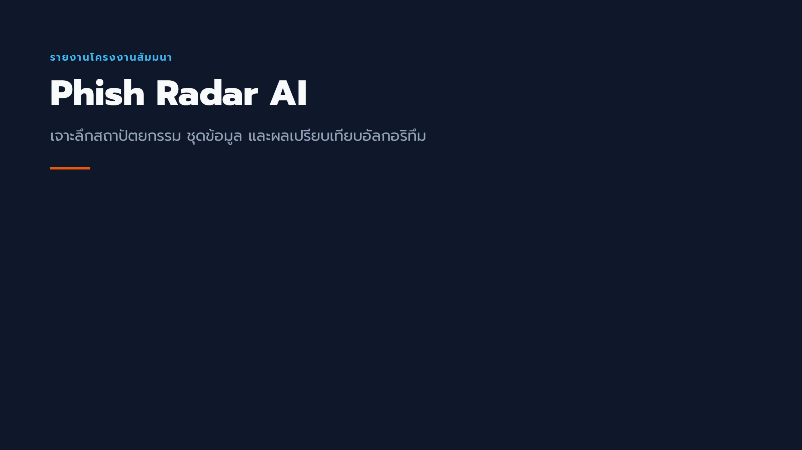](previews/slide-01.png)

## หน้า 2 จาก 12

[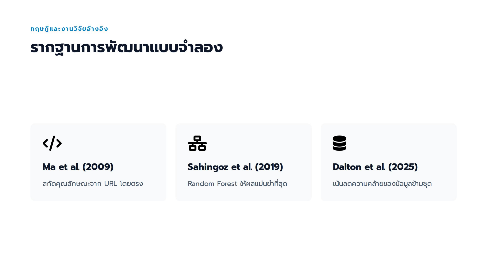](previews/slide-02.png)

## หน้า 3 จาก 12

[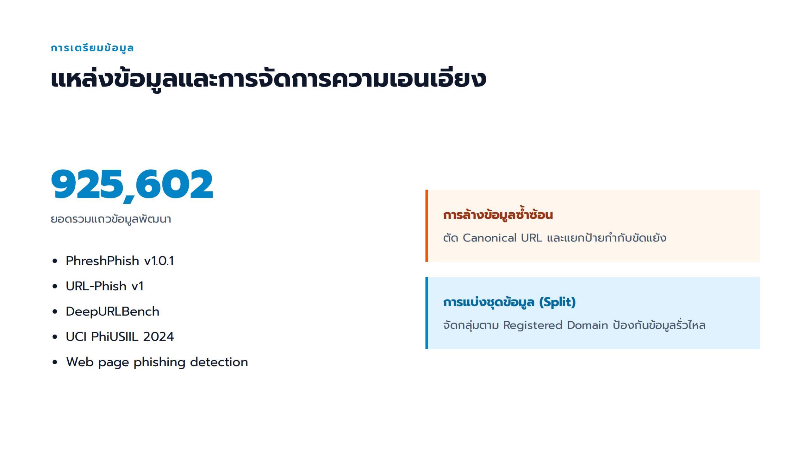](previews/slide-03.png)

## หน้า 4 จาก 12

[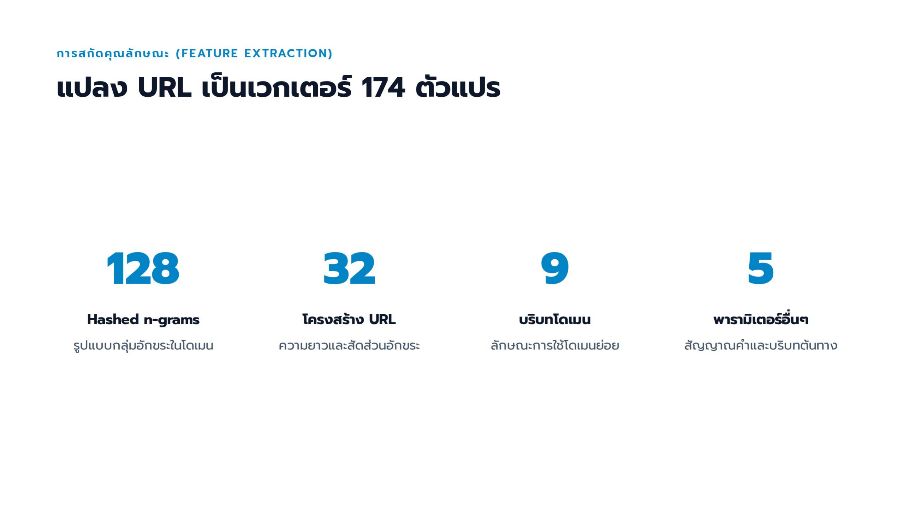](previews/slide-04.png)

## หน้า 5 จาก 12

[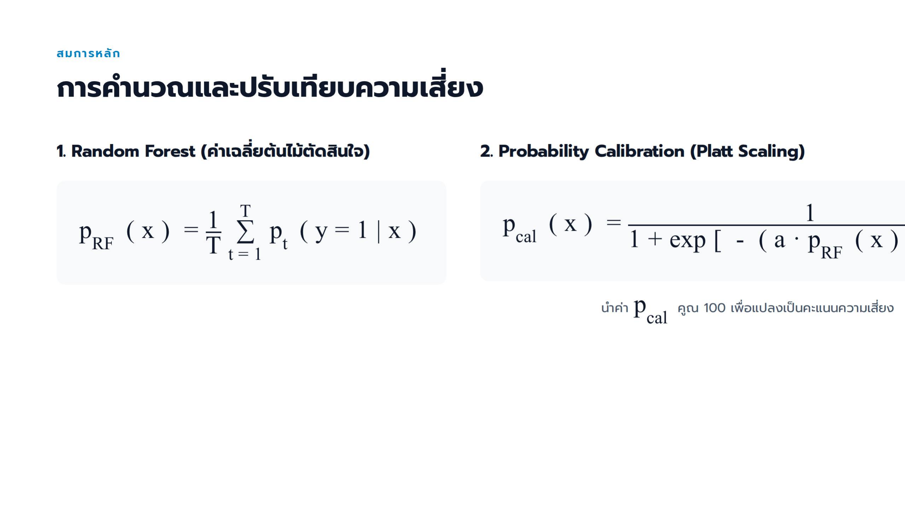](previews/slide-05.png)

## หน้า 6 จาก 12

[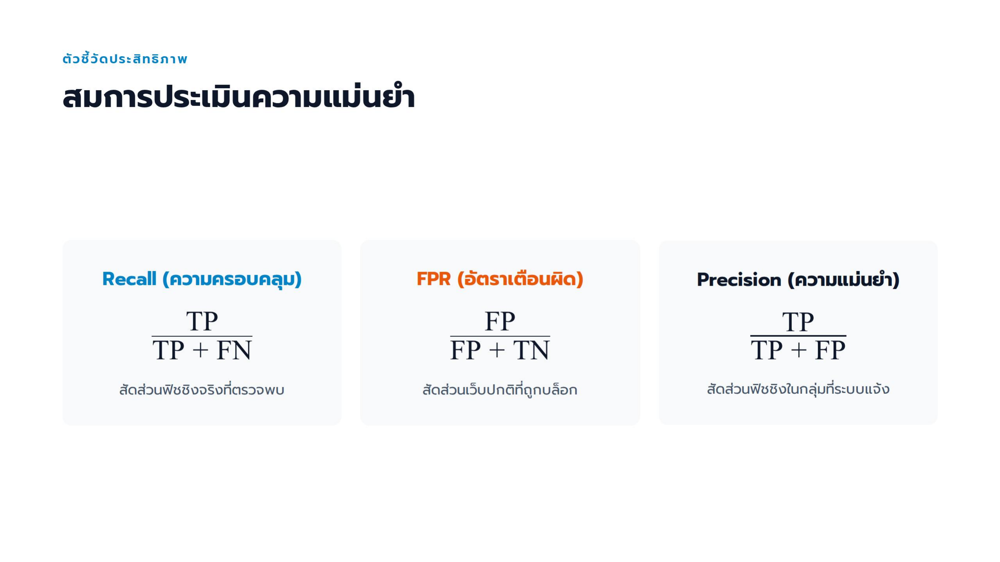](previews/slide-06.png)

## หน้า 7 จาก 12

[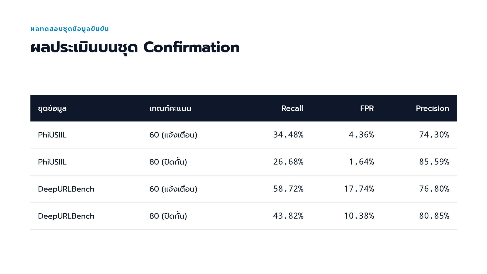](previews/slide-07.png)

## หน้า 8 จาก 12

[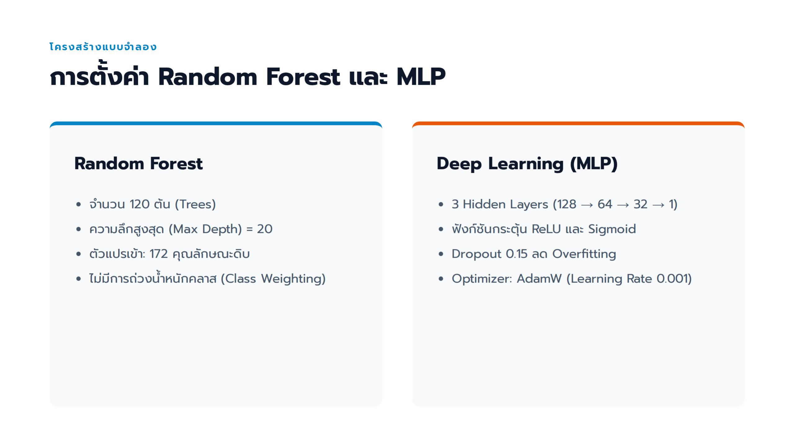](previews/slide-08.png)

## หน้า 9 จาก 12

[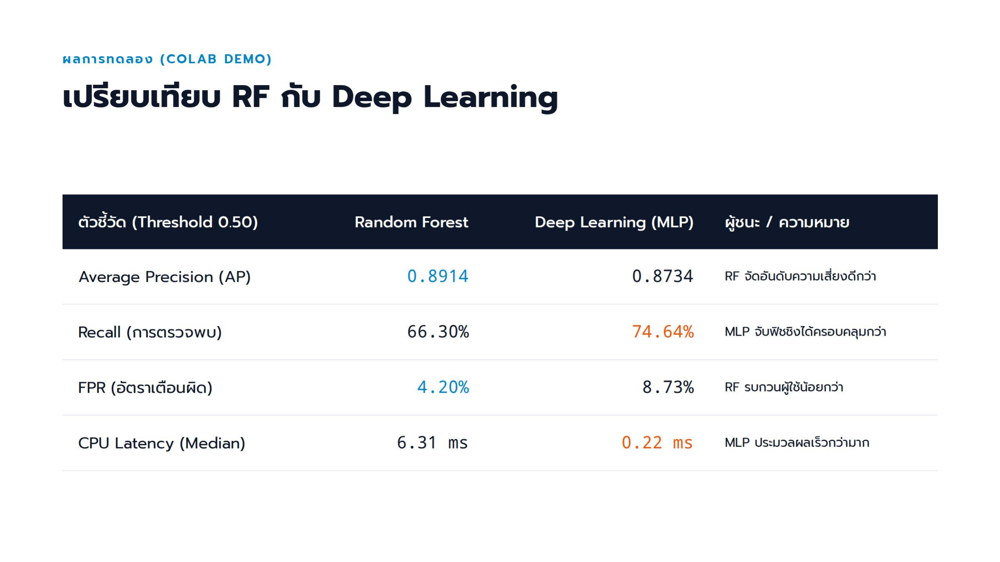](previews/slide-09.png)

## หน้า 10 จาก 12

[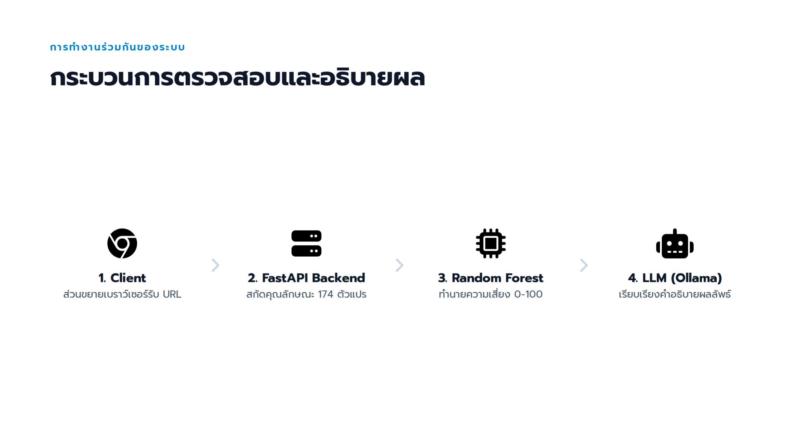](previews/slide-10.png)

## หน้า 11 จาก 12

[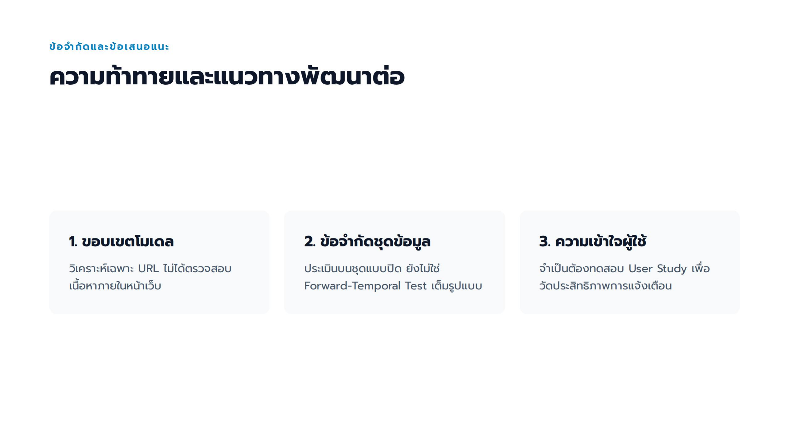](previews/slide-11.png)

## หน้า 12 จาก 12

